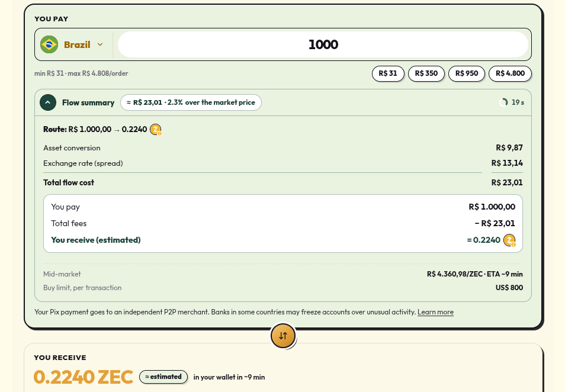

0xramp charges **zero product fees**. All fees come from the underlying integrations (P2P.me and NEAR Intents) and are shown in full before you confirm any order.

## Fee components

Every order includes up to three fee components:

- **Fixed fee**: a small flat amount per order. Most noticeable on small orders since it doesn't scale with size.
- **Asset conversion**: the cost of routing through NEAR Intents to convert USDC to your target asset (or vice versa).
- **Exchange rate spread**: the difference between the mid-market rate and the rate used in your trade. This compensates P2P.me merchants for providing liquidity.

Larger orders generally have a lower fee percentage because the fixed fee is spread over a bigger amount.

## Quotes are estimates

The quote shown is calculated from market conditions at the moment you enter the order. Between quote and on-chain settlement, prices can move.

- The **estimated amount** is what you'd receive if the rate holds.
- The **actual amount** is determined at settlement.
- The fiat payout on a sale is labeled as an **estimate** (≈) in the form; the final amount is set by the USDC the conversion actually delivers.

For most orders the difference is small. During high volatility it may be more noticeable. 0xramp does not guarantee a fixed price between quote and settlement.

<Note>
  There are no hidden fees. Everything you pay is shown in the quote before you confirm.
</Note>
