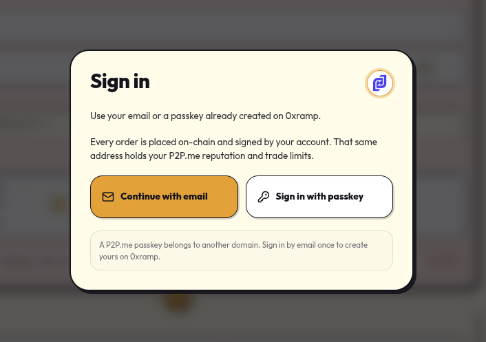

0xramp supports wallet creation via email or passkey. Wallets are compatible with the P2P.me ecosystem, meaning you can use the same wallet here or in another P2P app.

## P2P.me account

A P2P.me account is a gas-sponsored smart contract wallet on Base. Your identity lives on-chain, transaction fees are covered, and your limits and reputation are portable across any app that uses P2P.me (including [app.p2p.me](https://app.p2p.me)).

To sign in: go to [0xramp.app](https://www.0xramp.app), click **Sign in**, and use the same email or passkey of your P2P.me account.

## Your first order

<Steps>
  <Step title="Connect">
    Sign in or connect your wallet at [0xramp.app](https://www.0xramp.app).
  </Step>
  <Step title="Choose a flow">
    Pick Buy, Sell, Swap, or Pay with QR from the sidebar.
  </Step>
  <Step title="Start small">
    Use the minimum amount shown in the UI for your first trade. Review the quote carefully before confirming.
  </Step>
</Steps>

<Note>
  0xramp never stores your private keys, seed phrases, bank credentials, or Pix/UPI login details.
</Note>
