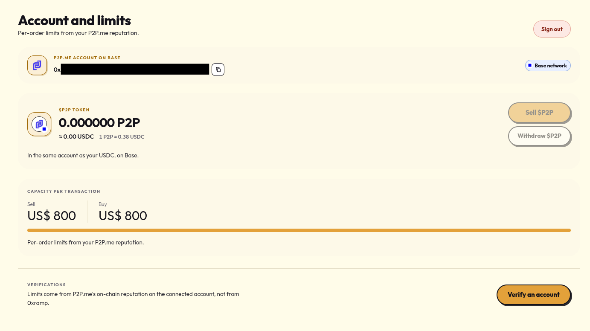

Trading limits on 0xramp come from your **on-chain reputation on P2P.me**, not from 0xramp. They are portable across every app built on P2P.me.

## Default limits

New accounts start with conservative limits:

- **Buy:** zero until verification is completed or order history is established.
- **Sell:** a modest starting allowance, shown in the app's **Account and limits** page.

Exact figures are set by P2P.me and vary by corridor. Always check the in-app **Account and limits** page for your current numbers.

## How to increase limits

<Steps>
  <Step title="Open Account and limits">
    In [0xramp.app](https://www.0xramp.app), go to **Account and limits** in the sidebar.
  </Step>
  <Step title="Verify your account">
    Click **Verify an account**. P2P.me offers ZK-KYC (zero-knowledge identity verification). It proves you meet identity standards without sharing your raw personal data with 0xramp or anyone else.
  </Step>
  <Step title="Build order history">
    Successful trades contribute to your on-chain reputation over time and may further increase your limits.
  </Step>
</Steps>

<Note>
  If you can't increase your limits following the steps above, get in touch via our [Telegram Support Group](https://t.me/zeroxramp). You will be asked to join the group, follow [0xramp Labs on X](https://x.com/0xramplabs) with an old account, and complete a few other verification steps for manual increase.
</Note>
